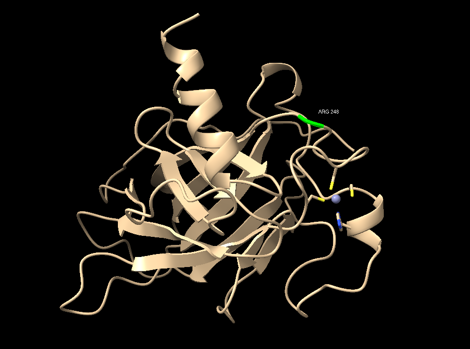

**Scientist’s Mission**

**Who Stole TP53’s Superpower? Searching for the Key to Unlock Cancer**

**Using AI to Uncover the Secrets of TP53–DNA Interactions**

**1. 【The LEGO Assembly Line】**

What type of bond links amino acids together to form a protein? Which
amino acids form hydrogen bonds with each other?

**Answer:**

1)  **Amino acids are linked together by peptide bonds to form a
    polypeptide chain.**

2)  **Hydrogen bonds form between suitable hydrogen-bond donors and
    acceptors, rather than between only specific pairs of amino acids.**

**一、哪些胺基酸可以形成氫鍵？**

**胺基酸形成氫鍵時，要先區分兩個部分：**

- **主鏈（backbone）：大多數胺基酸都有主鏈的羰基（C=O）與
  N–H，可以參與氫鍵。**

- **側鏈（side
  chain）：不同胺基酸的側鏈不同，因此形成氫鍵的能力也不同。**

**以下是常見的例子：**

| **胺基酸**     | **英文／縮寫**          | **側鏈能否形成氫鍵？** | **原因**             |
|----------------|-------------------------|------------------------|----------------------|
| **絲胺酸**     | **Serine (Ser)**        | **可以**               | **–OH 羥基**         |
| **蘇胺酸**     | **Threonine (Thr)**     | **可以**               | **–OH 羥基**         |
| **酪胺酸**     | **Tyrosine (Tyr)**      | **可以**               | **酚羥基 –OH**       |
| **天門冬醯胺** | **Asparagine (Asn)**    | **可以**               | **醯胺基 –CONH₂**    |
| **麩醯胺**     | **Glutamine (Gln)**     | **可以**               | **醯胺基 –CONH₂**    |
| **天門冬胺酸** | **Aspartic acid (Asp)** | **可以**               | **羧酸／羧酸根基團** |
| **麩胺酸**     | **Glutamic acid (Glu)** | **可以**               | **羧酸／羧酸根基團** |
| **組胺酸**     | **Histidine (His)**     | **可以**               | **咪唑環上的氮原子** |
| **色胺酸**     | **Tryptophan (Trp)**    | **可以**               | **吲哚環上的 N–H**   |
| **精胺酸**     | **Arginine (Arg)**      | **可以**               | **胍基上的 N–H**     |
| **賴胺酸**     | **Lysine (Lys)**        | **可以**               | **胺基上的 N–H**     |

**2. 【The Double-Track Highway of Life’s Blueprint】**

How do nucleotides assemble to form double-stranded DNA? What are the
basic structural components of DNA? Is DNA right-handed or left-handed?
List the names of the four DNA bases. Which bases form hydrogen bonds
with each other?

**Answer:**

**Nucleotides are linked together by phosphodiester bonds to form a DNA
strand. Two DNA strands are held together by hydrogen bonds between
complementary bases and form a double helix. The two strands run in
opposite directions (antiparallel).**

**DNA consists of nucleotides, each containing three components:**

- **Phosphate group（磷酸基）**

- **Deoxyribose sugar（去氧核糖）**

- **Nitrogenous base（含氮鹼基）**

**The most common form of DNA under physiological conditions, B-DNA, is
right-handed.**

**DNA base（英文）中文名稱 縮寫**

**Adenine腺嘌呤 A**

**Thymine胸腺嘧啶T**

**Guanine鳥嘌呤 G**

**Cytosine胞嘧啶 C**

**Adenine (A) pairs with Thymine (T) through 2 hydrogen bonds.**

**Guanine (G) pairs with Cytosine (C) through 3 hydrogen bonds.**

**3. 【Searching for My One-and-Only Soulmate in the Universe: A
20-Base-Pair Love Code Hidden Among 3 Billion DNA Base Pairs】**

**The source of molecular stability and specificity: hydrogen bonding —
How do TP53 and DNA recognize each other?**

Using the structure **3KMD**, identify one pair of an **amino acid and a
DNA base** that interact with each other.

**Answer:**

**TP53 encodes the p53 protein, which recognizes specific DNA sequences
through hydrogen bonds and other non-covalent interactions between amino
acid residues and DNA bases. These interactions provide specificity and
stability, allowing p53 to bind DNA and regulate gene expression.**

**4. 【Return to the Crime Scene】**

Why can a mutation (change) in just **one amino acid** of a protein
sometimes lead to a serious human disease? Give one specific example of
such a disease.

**Answer:**

**A mutation in just one amino acid can cause a serious human disease
because the amino acid sequence determines a protein’s three-dimensional
structure and function. Changing one amino acid can alter the protein’s
shape, stability, or interactions with other molecules, preventing it
from functioning properly. In some cases, the altered protein may also
interfere with normal cellular processes.**

**Example: Sickle cell disease**

**Sickle cell disease is caused by a single amino acid substitution in
the beta-globin protein of hemoglobin. At position 6, glutamic acid is
replaced by valine (Glu6Val). This change causes hemoglobin molecules to
stick together under low-oxygen conditions, making red blood cells
become rigid and sickle-shaped. These cells can block blood vessels and
break down easily, leading to pain, anemia, and organ damage.**

**5. 【Return to the Crime Scene: Searching for Clues】**

Using the TP53–DNA structure (**3KMD**), identify **one TP53 amino acid
mutation** that can lead to uncontrolled cell division and contribute to
the development of cancer.

Then examine this amino acid in **ChimeraX**. Based on its
three-dimensional position, determine whether the mutated amino acid is
located directly at the **protein–DNA interface** or somewhere else in
the protein.

**Answer:**

1.  Paste a screenshot of your ChimeraX visualization here.

**b.** Save your ChimeraX session file as **StudentID.cxs**.
